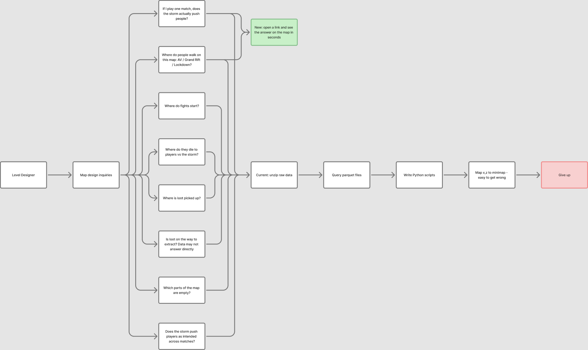
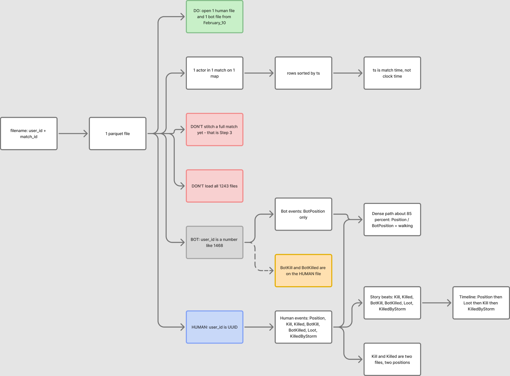
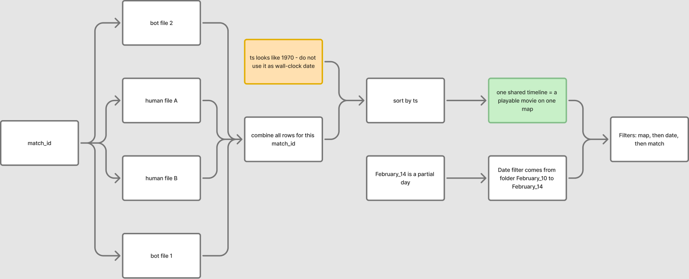
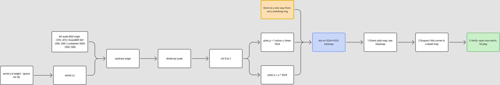

# How we used Cursor (and Figma) — assignment to deliverable

This is the working trail for the LILA Product Engineer written test. We used **Cursor** as the place to read the brief, inspect real match files, argue about the product, and then build. We used **Figma / FigJam** to lock the problem on a whiteboard *before* picking a stack.

The live tool is what a Level Designer would open. This note is what a reviewer can follow if they want to see how the understanding was built.

---

## 1. Read the assignment as a product test

The job description and the written test are the same loop: **idea → evidence**, owned end-to-end.

The user is a Level Designer. They have parquet match files and minimap pictures. They cannot *see* how players move, fight, loot, and die on those maps. Opening Python and guessing coordinates is how people give up.

So the product is not “a heatmap.” It is a link a designer can open, trust, and act on — plus proof that we learned something about LILA BLACK from the tool itself.

That is **our reading of the assignment**. It is enough to ship a first useful loop. It is not a substitute for sitting with the level design team (see the end of this note).

---

## 2. Do not open a framework yet

We asked Cursor for basic understanding steps first, not a React scaffold.

The check we used: *can we draw the user’s question, one parquet file, one match timeline, and world→minimap on a board?* If not, code would just freeze the confusion.

Cursor also opened the real `player_data/` files (not only the README) so every later diagram was tied to a filename, an event name, and a timestamp.

---

## 3. Whiteboard first — Excalidraw, then Figma

We started in **Excalidraw** (text-to-diagram). Step 1 was usable. Step 2 was not: the AI invented a film / audio / house workflow. None of the assignment was on the page (one file = one actor, UUID vs numeric id, `Kill` vs `Killed`).

Cursor has **no Excalidraw connection**, so it could only review screenshots, not fix the board.

We authenticated the **Figma MCP** in Cursor (account: Deepak Ram Sutrakar) and generated four **FigJam** boards on the personal team — same labels we had already locked from the parquet, not a fresh invention.

These boards were for **understanding**, not for the product UI.

### The four FigJam boards

Screenshots live in this repo so a reviewer does not need a Figma seat. Open the board if you want to zoom.

**Step 1 — Problem**  
The designer’s map questions vs today’s path (unzip → query parquet → guess `x,z` → give up) vs the target (open a link, see the answer on the minimap).

[Open FigJam](https://www.figma.com/board/aWH530AvICG0kE8ybVGclL)

**Step 2 — One file = one actor**  
Filename `{user_id}_{match_id}` → one actor in one match. UUID = human. Short number = bot. `BotKill` / `BotKilled` live on the **human** file. Do not stitch the whole match yet.

[Open FigJam](https://www.figma.com/board/ow5AUEdpdlea90GJBFfD57)

**Step 3 — Match timeline**  
Many files share a `match_id`. Sort by `ts`. One shared clock = a playable movie on one map. Filter order: map → date → match. `ts` looking like 1970 is a trap.

[Open FigJam](https://www.figma.com/board/5jmBtOkcZt9bgxAbwdXknP)

**Step 4 — Coordinates + UX loop**  
World `(x, z)` → UV → pixels, with **Y flip**. Then the product loop we actually shipped: Orient (heat) → Suspect → Verify (Play).

[Open FigJam](https://www.figma.com/board/D9q9GFYL5vQ1C5iflXdeka)

---

## 4. What Cursor helped us catch in the data

These showed up by querying files in the terminal, not by trusting the README:

| Trap | What we would have shipped if we missed it |
|---|---|
| Parquet type says `timestamp[ms]`; raw ints are **Unix seconds** (Feb 2026) | Matches that last 0.4s and a clock in 1970 |
| Same `(user_id, match_id)` in two day folders | Double-counted humans |
| Date = UTC of `t0`, not folder `February_10` | One match on `2026-02-09`; Feb 14 is partial |
| UUID = human; numeric id = bot | Bots drawn as players (or the reverse) |
| `y` is elevation; plot `(x, z)` + Y-flip | Paths mirrored into the void |
| No extract event | A fake “loot on the way to extract” chart |
| Almost every match is **1 human** | A BR / third-party story the data does not support |

Those traps are documented in `ARCHITECTURE.md` and baked into `scripts/etl.py`.

---

## 5. Then we chose a stack from the UX loop

Only after the boards:

1. **Orient** — land on a map, see traffic heat.
2. **Suspect** — “nobody goes east” / “this corner kills.”
3. **Verify** — one match, hit Play.

That loop needs playback, toggles, and a shareable URL. A Streamlit notebook fights all three and needs a live Python process. Spark / a warehouse is costume for ~8MB of events. PixiJS is right for thousands of sprites, not eight bots on a picture.

We shipped **Python ETL once → static JSON → Vite + React + Canvas 2D**, hosted on Vercel. Drawing is isolated in `src/mapRenderer.ts` so Pixi can replace Canvas later without rewriting filters.

Plan → approval → build was the working agreement in Cursor for the rest of the repo.

---

## 6. Build, learn, ship

| Stage | What Cursor did | What we kept |
|---|---|---|
| Kitchen | `scripts/etl.py` → `public/data` + compressed minimaps | Browser never reads parquet |
| Dining room | Filters, legend, playback, heat layers | Default: one map, one date, one match |
| Evidence | Used the tool, then counted the same slice | `INSIGHTS.md` (PvE not BR; unused east of Ambrose Valley; storm ~5% of deaths) |
| Hosting | Static Vercel, no env vars | Live URL on the README |
| Explain | Architecture for a designer *and* an engineer | `ARCHITECTURE.md` |
| Show | 60s recording of the live site (`npm run record`) | GIF plays in the README; MP4 in `docs/` |

---

## 7. What this assignment cannot replace

The parquet tells us where people **walked**. It does not tell us whether that is a **problem**.

“Unused east of Ambrose Valley” is a finding. Whether to cut that wing, move loot, or move an extract is a conversation with people who own the map. Playback, layer names, and “what does a good match look like?” will get better only if we talk to Level Designers regularly — playtests, map intent, which overlays they trust.

This repo is the first loop from the brief and the files. The next loops need that team.

---

## Files to read next

- `README.md` — how to open the tool
- `ARCHITECTURE.md` — product + coordinates + stack
- `INSIGHTS.md` — three findings from using it
- `docs/walkthrough.mp4` — original 60s recording
